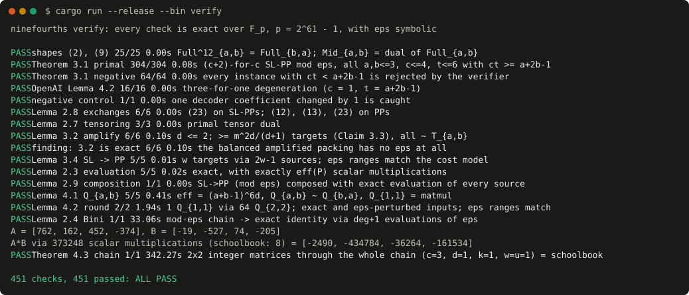
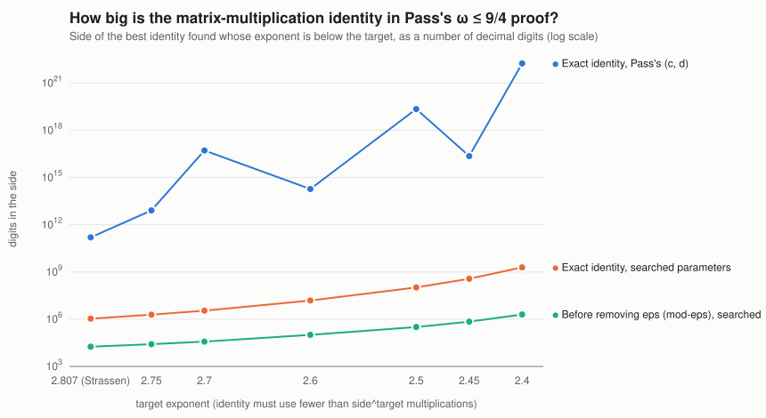

# ninefourths

On November 24, 2026 OpenAI posted a preprint claiming that the matrix multiplication exponent ω is exactly 9/4. The upper bound comes from October, and the new lower bound has not yet been checked outside OpenAI. Rafael Pass then published an explicit, constructive algorithm for the upper bound ([arXiv 2610.28627](https://arxiv.org/abs/2610.28627)). This repo builds that algorithm, runs it, and works out what it costs.

**Following Pass's own parameter rules, the smallest exact identity whose exponent beats Strassen's 2.807 has side 10^(7.3×10^15). Searching the free parameters of the same lemmas brings that down to 10^1,078,625 — a matrix side with about a million digits. On multiplication count alone, the algorithm cannot beat Strassen on anything smaller.** Almost all of that size comes from removing the formal parameter ε at the end (Bini's conversion). Before that step, the identity already has exponent 2.71 at side 10^17,977.

Along the way the build turned up one fact the paper doesn't state: **the amplified packing of Lemma 3.2 is exact.** The ε cancels identically on the balanced targets the lemma keeps, so every ε in the final algorithm comes from the interpolation in Lemma 3.4.



Every construction in the proof is a working program here. The primal (c+2)-for-c gadget, role exchanges, tensoring, amplification, the same-left-to-general conversion, interpolation, the round, composition, and Bini's conversion are each built as an explicit bilinear algorithm. Each is checked exactly at random points of F_p, with ε carried symbolically. The whole chain then multiplies real integer matrices and matches schoolbook. Two random 2×2 matrices take 373,248 multiplications, against 8 for schoolbook.



Every row is produced by `cargo run --release --bin cost` and stored in [`bench/cost_table.jsonl`](bench/cost_table.jsonl). "Pass" takes the smallest value the proof allows at each step. "Searched" applies the same lemmas with other parameter values. ε-degree is the degree in ε of the approximate identity, and h is the number of tensor powers Bini's conversion needs to remove it.

| target exponent | parameters | c | d | k | h | mod-ε side v (exponent) | ε-degree | exact side V | cannot beat Strassen below |
|---|---|---|---|---|---|---|---|---|---|
| log2 7 = 2.807 | Pass | 3 | 133 | 26,933 | 2.39×10^9 | 10^3,064,517 (2.807) | 10^9,926,214 | **10^(7.33×10^15)** | 10^(7.33×10^15) |
| log2 7 = 2.807 | searched | 5 | 209 | 147 | 60 | 10^17,977 (2.712) | 10^103,314 | **10^1,078,625** | 10^1,078,618 |
| 2.75 | Pass | 3 | 292 | 130,712 | 1.62×10^10 | 10^(3.32×10^7) (2.750) | 10^(1.06×10^8) | **10^(5.39×10^17)** | 10^(5.28×10^17) |
| 2.75 | searched | 6 | 265 | 194 | 76 | 10^25,704 (2.655) | 10^184,956 | **10^1,953,502** | 10^1,913,577 |
| 2.7 | Pass | 3 | 2,411 | 3,662,112 | 6.63×10^13 | 10^(7.81×10^9) (2.700) | 10^(2.47×10^10) | **10^(5.18×10^23)** | 10^(4.98×10^23) |
| 2.7 | searched | 6 | 320 | 238 | 92 | 10^38,019 (2.622) | 10^274,152 | **10^3,497,765** | 10^3,364,005 |
| 2.6 | Pass | 4 | 654 | 505,349 | 3.73×10^11 | 10^(2.30×10^8) (2.600) | 10^(1.03×10^9) | **10^(8.57×10^19)** | 10^(7.94×10^19) |
| 2.6 | searched | 7 | 545 | 428 | 152 | 10^101,568 (2.542) | 10^888,412 | **10^(1.54×10^7)** | 10^(1.43×10^7) |
| 2.5 | Pass | 5 | 6,879 | 61,739,695 | 1.78×10^15 | 10^(2.48×10^11) (2.500) | 10^(1.44×10^12) | **10^(4.40×10^26)** | 10^(3.92×10^26) |
| 2.5 | searched | 10 | 1,084 | 934 | 324 | 10^319,673 (2.458) | 10^4,365,716 | **10^(1.04×10^8)** | 10^(9.22×10^7) |
| 2.45 | Pass | 7 | 1,307 | 5,388,108 | 2.45×10^13 | 10^(3.04×10^9) (2.450) | 10^(2.69×10^10) | **10^(7.46×10^22)** | 10^(6.51×10^22) |
| 2.45 | searched | 13 | 1,743 | 1,617 | 536 | 10^698,348 (2.415) | 10^(1.32×10^7) | **10^(3.74×10^8)** | 10^(3.27×10^8) |
| 2.4 | Pass | 8 | 24,771 | 1,170,277,231 | 2.47×10^16 | 10^(1.12×10^13) (2.400) | 10^(1.16×10^14) | **10^(2.77×10^29)** | 10^(2.37×10^29) |
| 2.4 | searched | 16 | 3,207 | 3,043 | 984 | 10^1,991,526 (2.375) | 10^(4.90×10^7) | **10^(1.96×10^9)** | 10^(1.68×10^9) |

The line for Pass's rules jumps around because a lower target sometimes allows a larger c, and Pass's rules then pick a d and k just past the feasibility threshold. Right at that threshold the per-power margin in Bini's conversion is close to zero, so h becomes huge. The search avoids this by moving well past the threshold: it picks k so the mod-ε identity is already clearly below the target (2.71 instead of 2.807) and only then removes ε.

## Quickstart

```sh
cargo run --release --bin verify     # 451 exact checks, one line per lemma (~6 min; --quick skips the 2x2 run)
cargo run --release --bin cost       # faithful + searched cost for target exponent log2 7
TAUS=strassen,2.6,2.4 CMAX=60 DMAX=2500 cargo run --release --bin cost   # more targets, wider search
cargo test --release -- --include-ignored
```

Rust stable, no unsafe. The only dependency is `num-bigint`, used for the exact integers in the cost model.

## What is implemented

| Paper | Code | Checked |
|---|---|---|
| Def. 2.1 selected products, Full / Mid supports (2), (9) | `src/shape.rs` | Full^{12}_{a,b} = Full_{b,a}, Mid = dual of Full |
| Def. 2.2 packings (SL and general), modulo ε | `src/packing.rs` | exact verifier with ε symbolic |
| Thm 3.1 primal (c+2)-for-c packing | `gadgets::primal` | 304 parameter sets valid; all 64 sets with ct < a+2b−1 rejected |
| OpenAI Lemma 4.2 three-for-one degeneration | `primal(a, b, 1, a+2b−1, ..)` | 16 sets |
| Lemma 2.7 tensoring, 2.8 role exchanges, 2.9 composition (with the ε → ε^N substitution), 2.10 renaming | `Packing::{tensor, ex12, ex23, ex13, compose, rename_*}` | on primal, dual and SL→PP outputs |
| Lemma 3.2 amplification + Claim 3.3 word count | `gadgets::amplify` | ≥ m^{2d}/(d+1) targets, all isomorphic to T_{a,b} |
| Lemma 3.4 SL-PP → PP (points i + εj) | `gadgets::sl_to_pp` | w targets via 2w−1 sources |
| Lemma 2.3 evaluation in eff(P) scalar products | `gadgets::evaluate` | source count equals eff(P) exactly |
| Lemma 4.1 Q_{a,b} | `gadgets::q_shape` | eff = (a+b−1)^{6d}, Q_{a,b} ≅ Q_{b,a}, Q_{1,1} = matmul |
| Lemma 4.2 the round | `gadgets::round` | exact and ε-perturbed inputs |
| Lemma 2.4 Bini | `gadgets::bini` | mod-ε chain → exact identity |
| Thm 4.3 chain | `gadgets::minimal_chain` | 2×2 integer matrices, equal to schoolbook |
| Section 4 parameter rules, ε bookkeeping, Bini's h | `src/cost.rs`, `bin/cost` | ε ranges per lemma equal those measured on materialized packings (`tests/profiles.rs`) |

### How a packing is represented and checked

A packing is three sparse matrices whose entries are Laurent polynomials in ε over F_p, with p = 2^61 − 1. They are the left encoder, the right encoder and the decoder, together with the target and source shapes. The verifier draws random inputs from F_p, encodes them, multiplies the source products, and decodes. It then checks that the result minus the true target output has only positive powers of ε. Because ε stays a symbol, "valid modulo ε" is an exact property here, not a numerical one. All of the paper's identities are rational, so they hold over F_p whenever p divides no denominator. A wrong identity survives one random point with probability below about 10^-15 at these sizes (Schwartz–Zippel). A negative control flips one decoder coefficient and is always caught.

Role exchange is done generically. A packing is a trilinear identity between targets and sources, so exchanging two roles only permutes the three maps (EL, ER, Dᵀ) and re-indexes coordinates with the paper's conventions, Prod^{12} = Prod_{J,I,K}[r,q,p] and Prod^{23} = Prod_{I,K⁻¹,J⁻¹}[q,p,r]. Isomorphisms (Lemma 2.10) are found by searching variable permutations, which takes at most 720 at d = 1.

## The finding: Lemma 3.2's output is exact

Lemma 3.2 tensors the primal packing with its dual d times and keeps the words with exactly d Full and d Mid factors. The paper says validity modulo ε is preserved. In fact every ε cancels.

Each column of the primal right encoder carries a single power of ε: ε^0 for the P_j, ε^1 for Q. Each row of its decoder does too: ε^0 for Full outputs, ε^−1 for the middle product. The dual swaps the two maps. A kept word has α primal Mid letters and β dual-of-Mid letters, and the balance condition is exactly α = β. So every entry of the amplified right encoder carries ε^(α−β) = ε^0, and every decoder entry ε^(β−α) = ε^0. The amplified packing, for example 17 targets from 9 sources at (a, b, c, t, d) = (2, 1, 3, 1, 1), contains no ε at all, and the verifier confirms it is exact (`verify` line "finding: 3.2 is exact").

This matters for the cost. Without it, the ε-degree per round in the cost model would carry an extra factor of about (2d)² in each round. With it, the only ε left in the algorithm comes from the interpolation nodes i + εj of Lemma 3.4.

## How the cost is computed

Every quantity follows a formula in Section 4 of the paper. `src/cost.rs` cites the equation next to each one.

- m = c+2, n = c; u = n^{2d}, w = ⌈m^{2d}/(d+1)⌉ (8); Λ = ⌊w/u⌋² (Lemma 4.2); δ_L = ⌈(3L−1)/(n−1)⌉, L_{j+1} = L_j + δ_{L_j}, L_0 = 1.
- After k rounds, the mod-ε identity has side v_k = w²Λ^k and uses r = E_k = 64^k w^9 (2L_k−1)^{6d} scalar multiplications (proof of Thm 4.3). The 64 counts padded sources, as in the paper.
- **ε-degree.** Every map's ε-exponent range is tracked: tensoring adds ranges, role exchange permutes them, and composition first substitutes ε → ε^N into the inner packing, with N = pL + pR + pD + 1 (proof of Lemma 2.9), then adds. One round multiplies the negative range by about 9w², and k rounds are chained, so d_ε ≈ (9w²)^k. Each rule is checked against ranges measured on materialized packings. At sizes too large to materialize, the closed forms are upper bounds on the same rules.
- **Bini** (Lemma 2.4). The exact identity has side V = v^h and uses R = (h·d_ε + 1)·r^h multiplications, with h the smallest power making log_V R < target.
- **"Pass's rules"** takes the smallest value the proof allows at each step: the smallest c with threshold below the target, the smallest d satisfying (10), the smallest k with E_k < v_k^τ, and the smallest h. **"Searched"** applies the same lemmas over c ≤ 60, d ≤ 2500, and k from the first feasible value k_0 to 64·k_0 (1,500 log-spaced samples plus local refinement), with the smallest feasible h at each point. It minimizes R. This is a grid search, not a proof of optimality.

**Crossover bound.** Any use of the identity, even one level with padding, costs at least R multiplications. Strassen with padding costs at most 7^⌈log2 n⌉ ≤ 7·n^(log2 7). So the identity cannot win before n > (R/7)^(1/log2 7). This counts multiplications only and treats additions as free, so the true crossover is later. It is a statement about this identity, not about every algorithm with exponent 9/4.

## What this verifies and what it does not

- **Verified:** finite instances of every lemma, built exactly as the proofs describe and checked exactly, plus the full chain end to end on 2×2 integer matrices. Also, that the cost model's ε bookkeeping matches the materialized constructions.
- **Not verified:** the proof in general. The checks cover all a, b ≤ 3, but they say nothing about all a, b, t, about the counting in Claim 3.3 beyond the instances run, or about the limit argument in Thm 4.3. Pass's paper reports a Lean formalization of its rational identities (about 3,600 lines, generated by Aristotle). That is the stronger check of correctness, and this repo does not replace it. What this repo adds is concrete costs and a construction you can run.
- **The end-to-end run uses minimal retention.** The chain run keeps w = u = 1 (Observation 2.5 allows retaining fewer targets), so Λ = 1 and nothing is saved. It shows that primal → amplification → SL→PP feed the round correctly as separate pieces, and that the round, composition, Lemma 2.3 evaluation and Bini compose into a correct matrix multiplication. The source count matches the formula E_k = 64·3^6·x³. The smallest instance with real retention (c = 2, d = 1, w = 8, u = 4) needs about 10^14 scalar multiplications, so it is computed rather than run. No instance with an actual saving can ever be run.

## Design decisions

- **Exact over F_p, not floating point.** Bini-style algorithms cancel huge negative powers of ε. Any numerical ε would test approximation quality rather than the identity.
- **Materialized maps.** Each construction produces concrete sparse matrices, not a closure, so its ε-exponent ranges can be read off and compared with the cost model. The cost is memory. The 2×2 chain has 373,248 sources and takes a few minutes.
- **Paper's type labels for amplification.** When a + b − 1 = 1, Full and Mid have identical supports. The kept words are chosen by the labels in Claim 3.3 (primal Mid is the last target, the dual swaps types), not by looking at shapes. Choosing by shape keeps unbalanced words, which still carry ε.
- **Log space for the cost.** Exact big integers are used where they fit (u, w, ⌊w/u⌋ below 2^20000; L_k below 2^100). Beyond that, the code uses log2 values with upper-bound rounding.

## Limitations

- The search fixes the retained count at w from (8). It does not explore retaining fewer targets (smaller Λ, smaller ε-degree), the exact balanced count Σ_h C(d,h)²(c+1)^{2(d−h)} (larger than (8)), or the unpadded source count (2w−1)³ instead of 8w³. All three are small effects next to the ε-degree.
- Lemma 3.4 uses the paper's nodes i + εj. Other node choices with fewer negative powers might lower d_ε a lot. That would be a change to the construction, not a parameter, so it is left out.
- OpenAI's claimed lower bound is a separate, non-constructive argument and is not touched here.

## References

- R. Pass, *Matrix Multiplication from Polynomial Packings: A Constructive Proof of ω ≤ 9/4*, arXiv:2610.28627 (Oct 2026).
- OpenAI, *The matrix multiplication exponent is nine fourths* (preprint, Nov 24, 2026), github.com/openai/math, and the October upper-bound preprints. HN discussion, Nov 25, 2026.
- Doğan, Lysikov, Sakabe, Walter, *Tensor value and the 9/4 bound for matrix multiplication*, arXiv:2611.09716; *Semidirect sums of tensors and the matrix multiplication exponent*, arXiv:2611.04175.
- D. Bini, *Relations between exact and approximate bilinear algorithms. Applications*, Calcolo 17 (1980).
- P. Bürgisser, M. Clausen, A. Shokrollahi, *Algebraic Complexity Theory* (1997), Ch. 13–15.
- V. Strassen, *Gaussian elimination is not optimal*, Numer. Math. 13 (1969).

## License

MIT, Copyright (c) 2026 Ansor Juraev.
